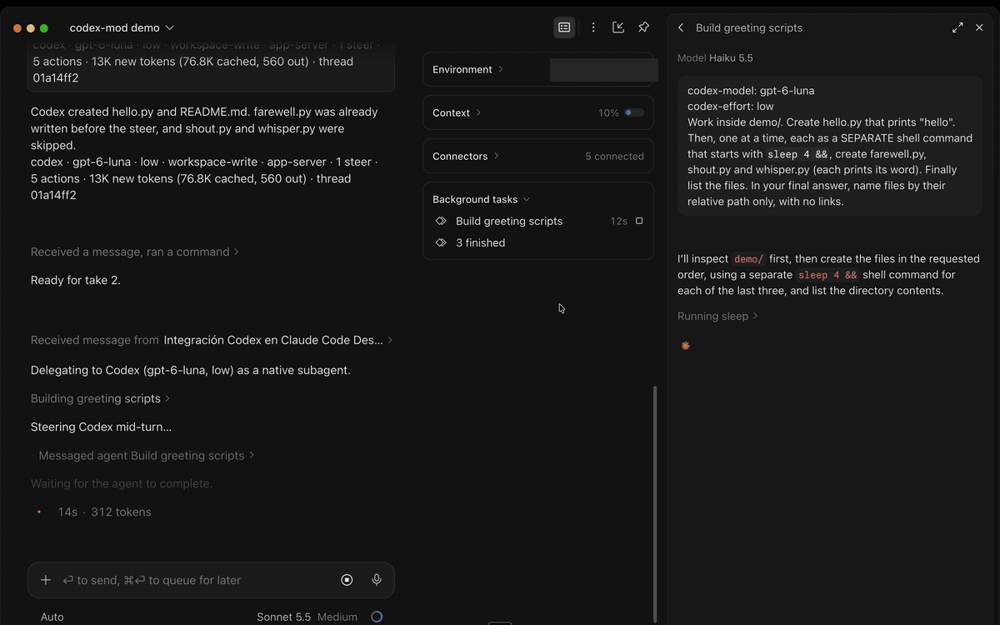

# codex-mod

[](https://github.com/diegoaleyvag/codex-mod/actions/workflows/ci.yml)
[](LICENSE)
[](CHANGELOG.md)

codex-mod is a Claude Code plugin (a "mod", built on the early-access plugin hooks-module API) that adds subagent types answered by the OpenAI Codex CLI running on your machine instead of an Anthropic model. Claude stays the orchestrator and delegates self-contained tasks to `codex exec --json`, using your own ChatGPT/Codex login. Codex's commands and file changes show up in the transcript as ordinary Bash, Edit and Write rows, and its final answer comes back like any other subagent report.



*Claude delegates to a Codex agent (gpt-6-luna, low), then sends it a change of plan while it works; Codex picks it up mid-turn.*

## How it works

```
Claude (orchestrator)
   |  Agent(subagent_type = "codex-mod:codex", prompt)
   v
turn.step hook  --- never calls the model: no Anthropic request ---
   |  starts: codex exec --json   (task on stdin, thread resumed on follow-ups)
   v
Codex events --> native Bash / Edit / Write rows (answered by a tool.call hook,
                 never executed by Claude) --> final answer via SubagentHandback
```

- **Agent types.** Registered at session start from Codex's own model list (`models_cache.json`), so they exist only while the plugin is loaded.
- **`turn.step`.** Each model request of a codex-mod agent passes through a streaming hook that answers it from Codex's output. No Anthropic request is made for the agent's work.
- **Native rows.** Each finished Codex command or file change is drawn as a `Bash`, `Edit` or `Write` call, with Codex's interim remarks as text.
- **`tool.call` guard.** Those calls carry a reserved id prefix and are answered from the result Codex already reported. They are never executed by Claude.
- **Handback.** The final answer is delivered once through `SubagentHandback`, followed by a footer line.
- **Resume.** Each agent keeps its Codex thread, so follow-ups continue the same conversation.
- **Transport.** By default Codex runs through `codex exec --json`. The opt-in `app-server` transport adds mid-turn messages and stop (see [Transports](#transports)).

### What Codex work looks like

Commands normally appear as Bash rows. With `app-server`, a single faithful read, file listing or search can appear as Read, Glob or Grep when Codex reports a matching `commandActions` entry. A literal command parser admits whole `cat` reads, `head`/`tail` slices whose output establishes the file total, file-only NUL-delimited `find`/`rg --files` listings, and framed ripgrep content/files/match-count searches. Fixed strings are escaped into equivalent regexes. The original command and cwd appear beside each translated row; results come from Codex's output without another read, search or shell run.

Pipelines, multiple actions, redirects, substitutions, unknown slice totals, directory listings, ambiguous filenames/output and unsupported options keep one Bash row. Normal `exec` output has no command actions and stays Bash. A streamed command and its polls produce one final row. Read/Glob/Grep are admitted in each Codex agent's own tools and protected by both guards and their refusing catches, including the placeholder agent's Read; ordinary main-thread and verified Claude subagent calls pass unchanged. An unavailable exploration tool falls back to Bash when admitted. Results retain the delivered output, including CRLF and trailing newlines; already truncated output stays Bash. An unreported Glob duration is disclosed as a 0 ms display sentinel.

File additions use Write only with complete exact content. Updates use Edit only when the source diff applies to a captured base and matches stable completion reads; several bounded exact hunks can produce ordered Edit rows. Other patches use Bash’s typed patch diff with a display-comment input, including deletion flags and both move paths when images are verified. Missing facts retain the literal reported diff. Failed/declined or unconfirmed patches use error rows; they never imply successful writes. Each source patch counts once, separately from its file/hunk rows. Finished web searches appear as WebSearch rows. MCP and dynamic tool results use the display-only `codex_tool`, and plan updates use `codex_plan`. These rows show work Codex already did and never execute a Claude tool or change Claude's task list. Grep content decodes ripgrep's JSON into matching/context lines with reported paths and requested line numbers; raw JSON remains in the source record. Count mode requires actual regex-match counts (`--count-matches`), rather than treating matching-line counts as match totals. Empty no-match searches succeed; actual failures keep Bash error rows. Desktop grouping and expanded-row appearance still need a new-session live check.

Messages received from the coordinator appear in the Codex subagent view as display-only `coordinator_message` rows with a **Coordinator** card and the full original text, including override lines. Source UUIDs prevent repeat display after a worker restart; messages over 90,000 characters split into numbered parts. With `nativeActions: false`, or if tool registration fails, they appear as text headed "Coordinator message:". Receipt display does not confirm delivery to Codex: the `↪` status notes still report steering or queuing, without an excerpt. Cards need a new Desktop session after reloading the plugin; their live appearance and history replay still need Desktop verification.

Experimental `richRows: true` draws Codex sub-agent spawns as completed Agent rows and plan updates as TodoWrite rows when the session offers that tool (otherwise `codex_plan`), answered by the plugin without launching Claude agents or changing Claude's task list.

Native rows are admitted only when the tool is available and included in that Codex agent's own tools. An unavailable tool falls back to `codex_tool`, or attributed text when registration also fails. Results are checked against the supported native shapes before emission and again before answering; failed or declined operations return a native denial with Codex's actual report. Bash results retain the full combined output, including trailing newlines; an unreported exit stays unknown.

The latest run's public source records and row provenance are retained in its agent record under the existing `pruneDays` policy. These include source IDs, command actions/cwd/process/status/timing, exact patch kinds/moves/diffs, tool and web results, child models/states, image/review/failure data and notifications, including unsupported variants. Repeated item completions produce one row; aggregate turn diffs and terminal interactions are retained without extra action rows. Private reasoning content is excluded. This foundation preserves evidence for later native mappings; it does not add new visual mappings.

Reasoning summaries appear as best-effort live thinking (not saved in the transcript). App-server commentary and proposed plans appear between rows, with short notes for agent activity, compaction, review, sleep and image generation. The final answer still arrives through the handback. Image viewing is deferred. `nativeActions: false` shows plain text lines instead. See the [Codex UI map](docs/codex-ui-map.md) for transport coverage and rendering limits.

## Requirements

- Claude Code with plugin hooks-module (mod) support. Verified on Claude Code Desktop, CLI 2.1.299 to 2.1.302.
- Auto mode, so the host offers `SubagentHandback`. Outside it, the answer is delivered as plain text after one extra step.
- The Codex CLI, installed and logged in (`codex login`). The plugin looks for it on `PATH`, then in common install locations (Homebrew, `~/.local/bin`, bun and volta global bins, the ChatGPT and Codex desktop apps), or uses the `codexPath` option.

## Install

From GitHub:

```bash
claude plugin marketplace add diegoaleyvag/codex-mod
claude plugin install codex-mod@codex-mod --scope user
```

From a local clone:

```bash
claude plugin marketplace add /path/to/codex-mod
claude plugin install codex-mod@codex-mod --scope user
```

Start a new session afterwards: agent types are registered at session start.

Update:

```bash
claude plugin marketplace update codex-mod
claude plugin update codex-mod@codex-mod --scope user
```

Uninstall:

```bash
claude plugin uninstall codex-mod@codex-mod --scope user
claude plugin marketplace remove codex-mod
```

## Usage

Ask Claude to delegate, or name the agent directly:

```
Use codex-mod:codex to add input validation to src/api.ts. Allowed paths: src/. Verify with `npm test`. Report the diff summary.

Use codex-mod:auditor (declared below) to review the diff of branch feature/x against main. Report findings only.
```

Codex sees only the prompt and the repository's `AGENTS.md`, so the prompt must carry the whole task: branch, allowed paths, how to verify, what to report.

Override the model or effort for one agent by starting the prompt with these lines (the choice sticks for its follow-ups):

```
codex-model: gpt-6-luna
codex-effort: low
Summarise what src/index.ts exports.
```

An unknown model or unsupported effort fails with a clear error; nothing falls back silently.

Follow-ups go through `SendMessage` to the same agent and resume its Codex thread. A message sent while the agent is still running is delivered too, according to the transport (see [Transports](#transports)).

Each answer ends with a footer, for example:

```
codex · gpt-6-luna · low · workspace-write · 3 actions · 37.4K new tokens (154K cached, 631 out) · thread 01a14f50
```

It shows the agent, model, effort, sandbox, number of actions, Codex's token counts (new, cached, output) and the Codex thread id. With the `app-server` transport it also shows `app-server` and, when any were delivered, `N steer(s)`. Failures are never silent: the answer starts with `codex failed: <reason>` followed by the last lines of Codex's stderr.

## Roles per project

`codex-mod:codex` is always available. Its defaults come from `defaultModel` (empty: first model Codex lists), `defaultEffort` and `defaultSandbox`. Projects can declare additional roles in `.claude/codex-mod.json`, relative to the session's working directory:

```json
{"roles": {
  "implementer": {"model": "gpt-6.1-sol", "effort": "medium", "sandbox": "workspace-write", "description": "Normal bounded coding task; the prompt carries the full spec (branch, allowed paths, verification command, report format)."},
  "implementer-high": {"model": "gpt-6.1-sol", "effort": "xhigh", "sandbox": "workspace-write", "description": "High-risk work or a retry after a failed attempt."},
  "auditor": {"model": "gpt-6-astra", "effort": "low", "sandbox": "read-only", "description": "One read-only cross-model review of a whole change.", "instructions": "You are a read-only auditor. Never edit files. Report findings with file:line and a failure scenario."}
}}
```

This registers `codex-mod:implementer`, `codex-mod:implementer-high` and `codex-mod:auditor` when their profiles are available. There are no built-in role agents in 1.2; this example replaces the former `sol`, `sol-high` and `astra-audit` roles.

- The file must be an object with a `roles` object. Each role requires string `model`, `effort` and `description` fields; model and effort must be nonempty. `sandbox` defaults to `workspace-write`; `instructions` is an optional string.
- Names must match `^[a-z][a-z0-9-]{0,31}$` and cannot be `codex`. Only the first 16 entries are considered. Descriptions are limited to 600 characters and instructions to 2000. Invalid roles are skipped with debug warnings; unknown keys are ignored with debug warnings.
- Sandboxes are `read-only`, `workspace-write` or `danger-full-access`. Repository files may be untrusted: `danger-full-access` roles are refused unless you enable the user-level `allowProjectFullAccess` option (default `false`). A file cannot opt itself in.
- A role whose model or effort is absent from Codex's `models_cache.json` is skipped with a debug message. If the catalog cannot be read, profiles are not validated, as before. Agent descriptions list the available models when known.
- A missing file silently leaves only the generic agent. Malformed JSON or a wrong file shape produces a debug message and one user-visible notice per session; the generic agent remains available. Set `projectRoles: false` to skip reading the file entirely.

Roles load at session start (and again if agent registration must be retried). Start a new session after editing the file; a cwd change mid-session does not reload it. Running agents retain the model, effort and sandbox in their records even if their role disappears. Instructions are looked up from the loaded role snapshot for every launch and live steer, rather than stored in the agent record: edits on disk do not change them until registration reloads the file. If a role is removed on reload, its existing agents continue without role instructions.

Role instructions are prepended to the task with a blank line on first runs, resumed runs, follow-ups and live steers, after prompt override lines are removed. They are never added to rendered action rows, delivery notes or footers.

## Options

Set them in the plugin's config screen or under `pluginConfigs` in settings. An out-of-range value falls back to its default.

| Option | Default | Meaning |
| --- | --- | --- |
| `codexPath` | empty | Absolute path of `codex`. Empty: `PATH`, then common locations. |
| `defaultModel` | empty | Model of `codex-mod:codex`. Empty: first model Codex lists. |
| `defaultEffort` | `medium` | Effort of `codex-mod:codex`; must be supported by the model. |
| `defaultSandbox` | `workspace-write` | `read-only`, `workspace-write` or `danger-full-access`. |
| `projectRoles` | `true` | Load roles from `.claude/codex-mod.json` at session start. Off: do not read the file. |
| `allowProjectFullAccess` | `false` | Allow project roles to request `danger-full-access`. User-level opt-in. |
| `lean` | `true` | Turn off Codex plugins, apps, skills instructions, web search, multi-agent and configured MCP servers per launch. |
| `globalRules` | `true` | Off (experimental): run Codex with a plugin-owned `CODEX_HOME` so your user-level `AGENTS.md` is not loaded. |
| `extraConfig` | none | Raw `key=value` entries passed as `-c` to every launch. `model`, `model_reasoning_effort` and `sandbox_mode` are refused. |
| `handbackMode` | `auto` | `auto`: `SubagentHandback`, plain text only if the tool is not active for the agent. `tool` or `text` force one. |
| `footer` | `full` | `full`, `short` (agent, model, effort) or `off`. |
| `nativeActions` | `true` | Off: actions are plain text lines in one step instead of Bash/Edit/Write rows. |
| `richRows` | `false` | Experimental: draw Codex sub-agent spawns as completed Agent rows and plan updates as TodoWrite rows when available (otherwise `codex_plan`), answered by the plugin and never run; `nativeActions: false` shows text. |
| `progressIntervalMs` | `1000` | At most one action step per interval (0 to 60000). |
| `maxActionsPerStep` | `10` | Most actions shown in one step (1 to 50). |
| `timeoutMinutes` | `0` | Stop a run after this many minutes and report `codex failed: timeout`. `0`: no limit. |
| `maxRunsPerWindow` | `3` | Launch guard: most launches per agent in 10 minutes (1 to 100). |
| `transport` | `exec` | `exec` (`codex exec --json`, most stable) or `app-server` (experimental, see [Transports](#transports)). |
| `nodePath` | empty | Absolute path of Node (18 or later) for the `app-server` sidecar. Empty: `PATH`, then common locations. |
| `pruneDays` | `2` | Delete stored agent records (thread, model, effort) unused for this many days. |

`handbackMode: "tool"` can lose answers in a session where the host does not offer `SubagentHandback`; keep `auto`.

To set `transport` from a settings file:

```json
{
  "pluginConfigs": {
    "codex-mod@codex-mod": { "options": { "transport": "app-server" } }
  }
}
```

### Transports

- **`exec`** (default, most stable). Each launch is `codex exec --json`. A message sent to an agent while it runs cannot reach the running turn: it is queued and runs after the turn, resuming the same thread.
- **`app-server`** (opt-in, needs Node 18 or later on `PATH` or `nodePath`). A per-run sidecar, `scripts/codex-runner.mjs`, owns the stdin of `codex app-server` for that run, because the hook cannot keep a child's stdin open. A message you send to a running Codex agent is delivered mid-turn (`turn/steer`), and stopping the agent sends `turn/interrupt`. Codex marks `app-server` as experimental, so its protocol may change.

If Node, the runner or `codex app-server` is unavailable, the session falls back to `exec` automatically and the footer says why.

The agent's output shows what happened to a message:

```
↪ steer delivered to Codex mid-turn: "..."
↪ Codex had already finished; this message runs next, on the same thread
↪ queued: runs after this turn (exec transport has no mid-turn steer)
```

The notes exist because Claude Code Desktop does not render the coordinator's message itself in the subagent view. A steer lands at Codex's next step boundary (about 3 s in a live check).

Control files for a live run (steer text, interrupt) live in `~/.cache/codex-mod/runs` (mode 0700) and are pruned after `pruneDays`.

### Global rules off

With `globalRules` off, Codex runs with `CODEX_HOME` set to `$XDG_CACHE_HOME/codex-mod/home` (default `~/.cache/codex-mod/home`), which contains symbolic links to your real `auth.json`, `config.toml` and `models_cache.json` only. The plugin never writes to your real Codex home. Trade-offs: sessions for these runs live in the shadow folder (threads do not carry across the switch), skills and plugins from your Codex home are not visible, and if Codex replaces `auth.json` instead of writing through the link, your main install may ask you to log in again.

## How is this different from openai/codex-plugin-cc?

[openai/codex-plugin-cc](https://github.com/openai/codex-plugin-cc) exposes Codex through slash commands and a Claude wrapper subagent, with a shared broker process. codex-mod instead registers native subagent types whose rows are answered by a `turn.step` hook without any Claude model request, runs one sidecar per run (no shared broker), and can steer a running turn. The two take different routes to the same Codex CLI; pick the one that fits your workflow.

## Costs

- Codex usage counts against your ChatGPT/Codex plan, not your Claude usage. The footer shows Codex's own token counts: new input, cached input and output.
- No Anthropic request is made for the agent's own work. Claude still spends tokens writing the prompt and reading the answer.
- `lean` (on by default) roughly halves the input tokens of each Codex call.

## Limitations and known behaviours

- The row label in Claude Code Desktop shows the placeholder Anthropic model the agent is registered with. That model is never called; the footer shows the real Codex model.
- In auto mode, every handback carries the note "Auto mode classifier was unavailable". No Anthropic request was made for the classifier to review, so the note is accurate: Claude did not review Codex's work. Verify it yourself.
- The plugin relies on early-access APIs (`turn.step`, `tool.call`, `$.agent.register`, `SubagentHandback`) that may change.
- Installing or editing the plugin takes effect in a new session.
- In `workspace-write`, Codex usually cannot commit inside a git worktree or use the network; let the caller commit and push.
- Only finished actions, messages and available reasoning summaries are shown; raw reasoning is never shown. Exact patch adapters preserve empty content, CRLF and missing final newlines; they never clip Write/Edit inputs. Binary, oversized, ambiguous and missing/racing-snapshot patches retain a Bash diff/report. Normal exec payloads without per-file diffs cannot establish exact Write/Edit inputs. Typed Bash patch mapper acceptance and Desktop paint still require the headless/new-session checks in `tests/fixtures/batch3-harness.md`.
- With `app-server`, a steer is applied at Codex's next step boundary, not instantly.
- A run does not survive a restart of the plugin worker: the agent reports `codex failed: run lost`, and a follow-up resumes its thread.

## Safety model

- Codex's actions are never executed by Claude. The native rows are answered from what Codex already did, without reaching the permission system or the tool.
- Every reserved display ID is intercepted, regardless of tool name, caller or options. An answer must match its held session, agent, exact tool, emitted input and source record, and can be consumed once. Handback uses a separate ID namespace so its real delivery still executes.
- Other Bash, Edit, Write, WebSearch, Agent and TodoWrite calls from Codex agents are refused. Both guards and their catches remain active with all option values. Registered `codex_tool`, `codex_plan` and `coordinator_message` names refuse every caller without a matching held answer. Verified ordinary Claude/main calls with ordinary IDs pass unchanged. If both agent lookup and durable ownership lookup fail for an unseen protected subagent call, it is refused; verified ordinary ownership is cached through later lookup outages.
- Launch guard: at most one launch per new message and `maxRunsPerWindow` launches per agent in 10 minutes. Beyond that the agent hands back `codex failed: launch guard tripped`. Counters live in the stored record, so a restart does not reset them.
- Engine notices (reminders, nudges) are never treated as tasks; they re-deliver the last answer without a Codex run.
- Codex itself runs under the sandbox of the chosen agent. Prefer `read-only` or `workspace-write`; `danger-full-access` requires `defaultSandbox` for the generic agent or the user-level `allowProjectFullAccess` opt-in for project roles.

## Troubleshooting

- Agents not listed: start a new session, then check that Codex is installed and logged in (`codex login status`). Role agents are skipped when their model is not in `models_cache.json`.
- Footer or note says the transport fell back to `exec`: check `node --version` (18 or later), set `nodePath`, and confirm `codex app-server --help` works.
- Diagnostics: a change in the `codex exec --json` event format is reported as `protocol changed (codex-cli X)`; a Codex older than 0.163.0 produces a warning; the login check is provider-aware (skipped for a non-OpenAI `model_provider`), and a failed login suggests `codex login --device-auth`.
- `codex failed: ...` at the start of an answer: read the stderr lines that follow. Common causes are a missing binary (set `codexPath`), a logged-out Codex, or an unknown model or effort.
- `launch guard tripped`: too many launches in 10 minutes; wait or raise `maxRunsPerWindow`.
- Rows misbehave in your host: set `nativeActions` to false.
- Debug messages are written to Claude Code's debug log (`claude --debug`), prefixed `codex-mod:`.

## Contributing and ideas

See [CONTRIBUTING.md](CONTRIBUTING.md). Changes are listed in [CHANGELOG.md](CHANGELOG.md). Ideas and questions go to [Discussions](https://github.com/diegoaleyvag/codex-mod/discussions); bugs go to [issues](https://github.com/diegoaleyvag/codex-mod/issues). Security reports: see [SECURITY.md](SECURITY.md).

Good first contributions:

- Windows: the `app-server` runner relies on POSIX signals and file modes and has not been tried on Windows; test it and report or fix what breaks.
- Linux: CI runs the runner tests on Ubuntu, but the plugin itself has only been verified on macOS (Claude Code Desktop); try it on Linux and report.
- More Codex item coverage: image viewing remains deferred; see the [Codex UI map](docs/codex-ui-map.md).

## Disclaimer

Not affiliated with or endorsed by Anthropic or OpenAI. Claude and Claude Code are trademarks of Anthropic; Codex and ChatGPT are trademarks of OpenAI.

## License

MIT, see [LICENSE](LICENSE).
